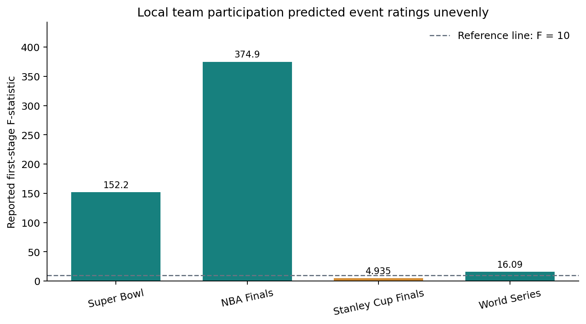
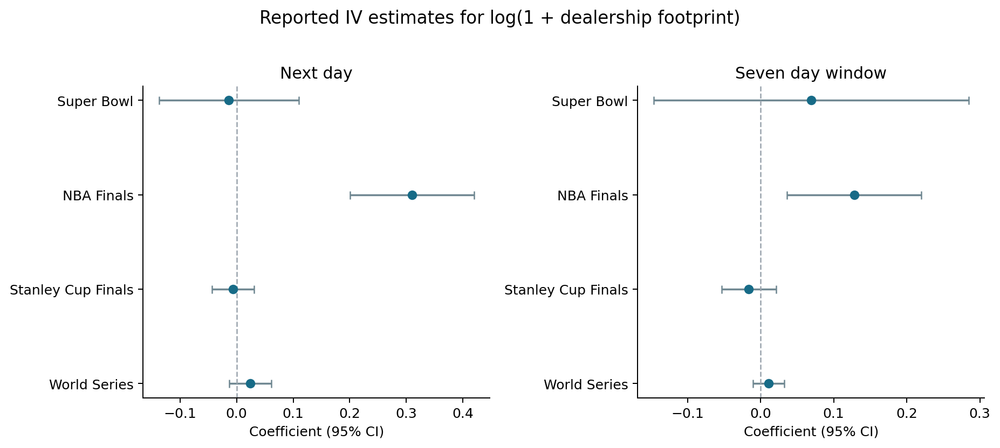

# Do Auto Ads During Championship Games Actually Work?

**An exploratory study of sports broadcasts, TV ratings, and dealership visits**  
*Completed graduate research project · 2018–2019 events · August 2021*

Can championship broadcasts reveal whether more exposure to auto ads is followed by more consumer interest? I studied four events—the Super Bowl, NBA Finals, Stanley Cup Finals, and World Series—using Nielsen ratings and advertising data alongside SafeGraph dealership visits.

## What I did

Local-team participation served as an instrument for changes in DMA-level TV ratings. I then used fitted ratings to estimate changes in visits to dealerships associated with advertised automakers. Models included DMA, year, and month fixed effects, with standard errors clustered by state.

## What I found

The results provide evidence of an advertising effect during the NBA Finals: reported estimates were positive and statistically significant across the four dealership-visit outcomes. For log-transformed outcomes, the estimates were **0.310 (SE 0.056)** for next-day visits and **0.128 (SE 0.047)** for the seven-day window.





The instrument performed unevenly: the first-stage F-statistic was 374.9 for the NBA Finals, 152.2 for the Super Bowl, 16.09 for the World Series, and 4.935 for the Stanley Cup. The Stanley Cup estimate raises a weak-instrument concern.

## Why is there no effect during the Superbowl?

The identification strategy I exploited is exogenous variation across regions with a participating championship team and non-participating regions. During the superbowl, the entire country tunes in, so it is harder to isolate this effect.

## Important caveat

The measured outcome is dealership visits, a proxy for consumer interest rather than completed sales or loan decisions. The causal interpretation depends on the exclusion restriction: local-team participation must affect dealership visits through advertising exposure rather than other channels.

```bash
python -m pip install -r requirements.txt
python scripts/plot_reported_results.py
```

The original Nielsen and SafeGraph source data and estimation code are not included. The script recreates figures from the reported table values; it does not rerun the analysis. See [REPRODUCIBILITY.md](REPRODUCIBILITY.md) for details.
